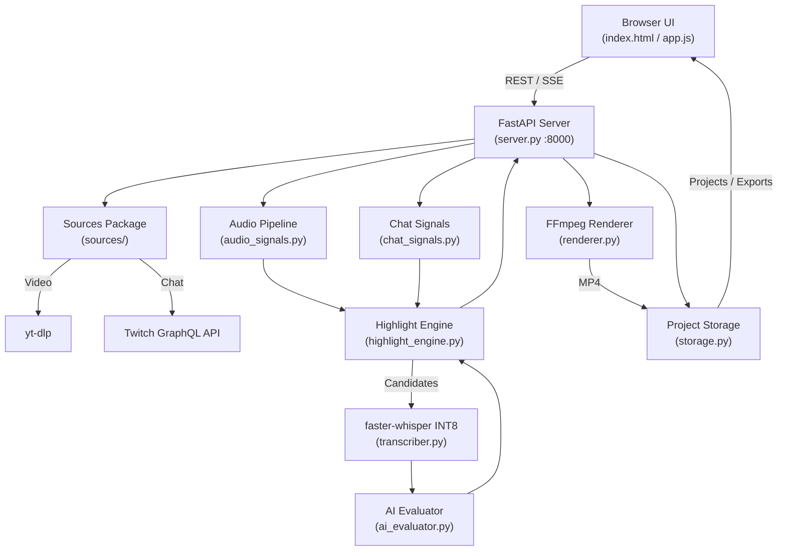

# GTA Clipper — Current Workflow Reference

> **Status Key Used Throughout This Document**
> - ✅ **Implemented and tested** — Feature exists, automated tests pass.
> - 🟡 **Implemented, not fully tested** — Code exists, no automated test coverage.
> - ❌ **Not implemented** — Planned but not built.
> - ⚠️ **Known limitation** — Works but with a documented constraint.

---

## Table of Contents

1. [System Architecture Overview](#1-system-architecture-overview)
2. [Installation](#2-installation)
3. [Launch](#3-launch)
4. [Startup Behavior](#4-startup-behavior)
5. [AI Provider Selection (First Launch)](#5-ai-provider-selection-first-launch)
6. [Supported URL Formats](#6-supported-url-formats)
7. [Platform Detection Logic](#7-platform-detection-logic)
8. [Video Probing (Pre-Download Preview)](#8-video-probing-pre-download-preview)
9. [Video Download — Twitch](#9-video-download--twitch)
10. [Video Download — YouTube](#10-video-download--youtube)
11. [Local File Import](#11-local-file-import)
12. [Chat Availability & Extraction](#12-chat-availability--extraction)
13. [Audio Pipeline](#13-audio-pipeline)
14. [Chat Signal Analysis](#14-chat-signal-analysis)
15. [Highlight Engine (Multi-Signal Fusion)](#15-highlight-engine-multi-signal-fusion)
16. [Speech Recognition (faster-whisper)](#16-speech-recognition-faster-whisper)
17. [AI Candidate Evaluation](#17-ai-candidate-evaluation)
18. [Highlight Scoring & Ranking](#18-highlight-scoring--ranking)
19. [The 9:16 Canvas Editor](#19-the-916-canvas-editor)
20. [Layout Modes](#20-layout-modes)
21. [Subtitle Styles](#21-subtitle-styles)
22. [Clip Trimming](#22-clip-trimming)
23. [FFmpeg Export Pipeline](#23-ffmpeg-export-pipeline)
24. [Save As Dialog (Windows)](#24-save-as-dialog-windows)
25. [Storage Layout](#25-storage-layout)
26. [Storage Cleanup](#26-storage-cleanup)
27. [Demo / Sample Project](#27-demo--sample-project)
28. [REST API Quick Reference](#28-rest-api-quick-reference)
29. [Known Limitations](#29-known-limitations)

---

## 1. System Architecture Overview



**Component summary:**

| File | Role |
|---|---|
| `run.py` | Entry point — starts Uvicorn + opens browser |
| `app/backend/server.py` | FastAPI REST & streaming endpoints |
| `app/backend/sources/` | Platform detection, video/chat download |
| `app/backend/audio_signals.py` | Audio feature extraction |
| `app/backend/chat_signals.py` | Twitch / YouTube chat feature extraction |
| `app/backend/highlight_engine.py` | Signal fusion, hype curve, candidate ranking |
| `app/backend/transcriber.py` | faster-whisper INT8 speech recognition & ASS subtitles |
| `app/backend/ai_evaluator.py` | Ollama / DeepSeek / OpenRouter / heuristics |
| `app/backend/renderer.py` | FFmpeg 1080×1920 MP4 rendering |
| `app/backend/storage.py` | Project state, metadata, disk management |
| `app/backend/facecam_detector.py` | Webcam overlay bounding box detection (OpenCV) |
| `app/backend/config.py` | Paths, constants, hardware config |
| `app/frontend/index.html` | Main SPA shell |
| `app/frontend/app.js` | Frontend state machine & API bindings |
| `app/frontend/canvas_editor.js` | 60fps HTML5 Canvas 9:16 editor |
| `app/frontend/styles.css` | Dark-mode gaming UI |

---

## 2. Installation

### Prerequisites

| Requirement | Version | Notes |
|---|---|---|
| Python | 3.11+ (3.13 tested) | Windows x64 |
| FFmpeg | Any modern build (9.0.2 tested) | Must be on `PATH` |
| yt-dlp | 2026.08.19+ | Installed as Python package |

### Python dependencies

```bash
pip install fastapi uvicorn[standard] pydantic requests yt-dlp \
            faster-whisper numpy scipy sherpa-onnx opencv-python-headless
```

> [!NOTE]
> `opencv-python-headless` is optional. Without it, facecam auto-detection and
> the frame thumbnail endpoint (`/api/projects/{id}/frame`) are disabled.
> All other features remain fully functional.

> [!TIP]
> `faster-whisper` automatically downloads the `tiny` Whisper model (~75 MB)
> on first use. Subsequent runs are instant as the model is cached.

### Optional: Local AI with Ollama

```bash
# Install Ollama from https://ollama.com/
ollama pull llama3.2:3b   # Recommended — fast 3B model
# or
ollama pull qwen2.5:3b    # Good alternative
```

The application runs fully without Ollama (heuristic fallback is automatic).

---

## 3. Launch

```bash
python run.py
```

This command:
1. Starts the FastAPI server via Uvicorn on `http://127.0.0.1:8000`
2. Opens the browser automatically to `http://127.0.0.1:8000`
3. Loads the main dashboard

The server runs in the foreground. Press `Ctrl+C` to stop.

> [!IMPORTANT]
> Do **not** run `python app/backend/server.py` directly for production use.
> `run.py` is the correct and supported entry point.

---

## 4. Startup Behavior ✅

On launch the application:

1. ✅ Starts the server
2. ✅ Loads the dashboard
3. ✅ Displays all genuine user-created projects (projects stored in `projects/`)
4. ✅ Shows an **empty state** ("No projects yet. Paste a URL above to get started.") when no projects exist

The application does **NOT**:

- ❌ Auto-download any video
- ❌ Auto-process any video
- ❌ Auto-load sample or demo projects
- ❌ Run test pipelines on startup
- ❌ Populate the project list with synthetic data

Processing begins **only** when the user pastes a URL and clicks **Start Processing**.

---

## 5. AI Provider Selection (First Launch) ✅

When a user opens GTA Clipper for the first time (detected by `!aiConfig || !aiConfig.configured`), an **AI Setup Onboarding Modal** is displayed before asking for a video URL.

The user selects between two primary options:

### Option A: Local AI (Recommended & Zero Cost)

| Provider | Description |
|---|---|
| **Ollama** | Connects to local Ollama at `http://localhost:11434`. The backend queries `GET /api/ai/ollama/models` which retrieves all installed models along with disk sizes and estimated RAM requirements. Recommended CPU-first model: `llama3.2:3b` (~2.0 GB disk, ~2.8 GB RAM). |
| **Heuristics Fallback** | When Ollama is not installed or running, the system falls back seamlessly to rule-based signal heuristics (audio dynamics, chat bursts, keyword tagging). Zero cost, 100% offline, no setup required. |

### Option B: Cloud API AI

| Provider | Description |
|---|---|
| **DeepSeek** | Uses DeepSeek Chat API (`deepseek-chat` model). Requires an API key. Includes live test connection button. |
| **OpenRouter** | Routes to any chosen LLM via OpenRouter. Requires an API key. |

> [!NOTE]
> API keys are stored locally in `.ai_config.json` at the project root. This file is git-ignored and never committed. Keys are masked in the UI (e.g. `sk-****...abcd`).

The AI configuration can be reopened and changed at any time by clicking the ⚙️ **AI Settings** button in the dashboard header.

---

## 6. Supported URL Formats ✅

### Twitch VOD URLs

```
https://www.twitch.tv/videos/2283066778
https://www.twitch.tv/username/v/2283066778
2283066778                                    ← bare numeric ID
```

### YouTube URLs

```
https://www.youtube.com/watch?v=dQw4w9WgXcQ
https://youtu.be/dQw4w9WgXcQ
https://www.youtube.com/live/dQw4w9WgXcQ
https://www.youtube.com/shorts/dQw4w9WgXcQ
https://www.youtube.com/embed/dQw4w9WgXcQ
https://www.youtube.com/v/dQw4w9WgXcQ
```

### Local File

```
C:\Users\User\Videos\gameplay.mp4
E:\clips\session.mkv
/home/user/videos/game.mp4
```

Supported local formats: any format decodable by FFmpeg (`.mp4`, `.mkv`, `.avi`, `.mov`, `.webm`).

---

## 7. Platform Detection Logic ✅

Detection runs in `app/backend/sources/detector.py` and applies in this priority order:

1. **Local file**: Does `Path(input).is_file()` return `True`? → `Platform.LOCAL`
2. **Twitch**: Does input match a Twitch URL pattern or contain `twitch.tv`? → `Platform.TWITCH`
3. **YouTube**: Does input match a YouTube URL pattern (6 patterns) or contain `youtube.com` / `youtu.be`? → `Platform.YOUTUBE`
4. **Default fallback**: Treated as a local path stem

The detected platform is shown as a colored badge next to the URL input field:
- 🟣 **TWITCH** (purple)
- 🔴 **YOUTUBE** (red)
- ⬛ **LOCAL** (grey)

---

## 8. Video Probing (Pre-Download Preview) ✅

Before downloading, the UI calls `GET /api/probe?url=<url>`.

The server uses `yt-dlp --dump-json` (no download) to extract:
- Video title
- Channel name
- Duration (seconds)
- Thumbnail URL
- View count

This data is shown as a **preview card** below the URL input (title, channel, duration, thumbnail) so the user can confirm before clicking **Start Processing**.

> ⚠️ Probing requires network access. Private, deleted, or region-restricted videos return a `400` error with a descriptive message.

---

## 9. Video Download — Twitch ✅

Handled by `app/backend/sources/twitch.py` via `yt-dlp`.

**Video**: Downloaded with `yt-dlp` at best available quality (1080p preferred). Saved as `projects/<project_id>/source.mp4`.

**Chat**: Fetched from the Twitch public GraphQL API:
- Endpoint: `https://gql.twitch.tv/gql`
- Operation: `VideoCommentsByOffsetOrCursor`
- Public client ID: `kimne78kx3ncx6brgo4mv6wki5h1ko` (no auth required)
- Pagination: Cursor-based until all messages fetched
- Bot filtering: Removes known bot accounts (`streamelements`, `nightbot`, etc.)
- Output: `projects/<project_id>/chat.json`

---

## 10. Video Download — YouTube ✅

Handled by `app/backend/sources/youtube.py` via `yt-dlp`.

**Video**: Downloaded with format merging (`bestvideo+bestaudio/best`). Saved as `projects/<project_id>/source.mp4`.

**Chat**: Available **only** on archived YouTube livestreams with chat replay enabled.
- Extracted via yt-dlp's `live_chat` subtitle track (`.live_chat.json` jsonlines format)
- Each line contains a timestamp and message payload
- Parsed into the same `chat.json` format as Twitch
- Regular YouTube uploads (non-livestreams) return `chat_status: "unavailable"` gracefully

> ⚠️ **Known limitation**: YouTube chat extraction depends on yt-dlp's `.live_chat.json` format, which may change with yt-dlp updates.

---

## 11. Local File Import ✅

Handled by `app/backend/sources/local.py`.

- The source file is **copied** (or hard-linked where possible) to `projects/<project_id>/source.mp4`
- If a file named `<basename>.chat.json` exists next to the source file, it is imported as chat data
- Audio extraction proceeds identically to downloaded sources

---

## 12. Chat Availability & Extraction ✅

| Platform | Chat Available? | Method |
|---|---|---|
| Twitch VOD | ✅ Always (public VODs) | Twitch GraphQL API |
| YouTube livestream archive | ✅ If replay enabled | yt-dlp `live_chat` track |
| YouTube regular upload | ❌ Unavailable | Falls back gracefully |
| Local file | ✅ If `.chat.json` present | Direct import |
| Local file (no chat) | ⚠️ Chat signals skipped | Audio-only detection |

Chat data is normalized to a common format:

```json
[
  {
    "offset_seconds": 142.5,
    "commenter": { "display_name": "StreamFan99" },
    "message": { "body": "KEKW KEKW KEKW LUL", "user_badges": [] }
  }
]
```

---

## 13. Audio Pipeline ✅

Implemented in `app/backend/audio_signals.py`.

### Step 1 — WAV extraction
FFmpeg extracts a **16kHz mono WAV** from `source.mp4`:
```
ffmpeg -i source.mp4 -ar 16000 -ac 1 audio.wav
```

### Step 2 — RMS loudness curve
- 0.5-second windows sliding over the full waveform
- Rolling adaptive baseline (120s median)
- **Loudness jump** = `current_dBFS - baseline_dBFS`
- Thresholds: +12 dB (mild), +20 dB (strong), +28 dB (extreme)

> [!WARNING]
> Loudness alone is intentionally **not** used as a highlight signal by itself.
> GTA gameplay has frequent explosions and gunshots that create false positives.
> Loudness is **one input** to the multi-signal fusion engine, not the sole detector.

### Step 3 — Audio event tagging
Two methods, used in order of availability:

| Method | Requirement | Tags |
|---|---|---|
| **CED-mini ONNX** (sherpa-onnx) | `models/ced-mini/model.int8.onnx` present | `laughter`, `shouting`, `cheering`, `crowd_applause` |
| **Spectral dynamics fallback** | Always available (NumPy/SciPy) | `high_energy`, `spectral_novelty` |

### Step 4 — Voice Activity Detection
Using `sherpa-onnx` or spectral energy fallback to detect speech presence.

---

## 14. Chat Signal Analysis ✅

Implemented in `app/backend/chat_signals.py`.

| Signal | Method |
|---|---|
| **Message velocity** | Rolling 10s window count vs 120s median baseline |
| **Velocity spike** | Ratio of `window_rate / baseline_rate` (e.g. 18.0× surge detected) |
| **Emote bursts** | Regex matching: `KEKW`, `WTF`, `POG`, `POGGERS`, `OMG`, `LUL`, `LULW`, `EZ`, `PepeLaugh`, `Clap`, 🎉, 😂, 👀, etc. |
| **Reaction words** | "bro", "wtf", "WHAT", "clip it", "omg", "no way", "LMAO", etc. |
| **Spam filtering** | Identical messages from one user within 2s are collapsed |
| **Bot filtering** | Known bot accounts removed before analysis |
| **Broadcast delay** | 5-second compensation applied to sync chat to video timestamp |
| **Unique user count** | Counts distinct users reacting in a window |

Output: per-second `chat_hype_score` curve, 0.0–1.0 normalized.

---

## 15. Highlight Engine (Multi-Signal Fusion) ✅

Implemented in `app/backend/highlight_engine.py`.

### Signal fusion weights (approximate)

| Signal | Default weight |
|---|---|
| Chat velocity spike | 0.40 |
| Audio loudness jump | 0.25 |
| Audio event tag | 0.20 |
| Speech transcription keywords | 0.10 |
| AI candidate score (when available) | 0.05 bonus |

### Pipeline steps

1. **Merge signals** — all per-second signals interpolated to same resolution
2. **Agreement bonus** — extra weight when multiple signals spike simultaneously
3. **Gaussian smoothing** — removes isolated noise spikes
4. **Peak picking** — finds local maxima above threshold with `DEFAULT_MIN_GAP = 35s` between peaks
5. **Boundary calculation** — `peak - DEFAULT_PRE_ROLL (6s)` to `peak + DEFAULT_POST_ROLL (4s)`, bounded by `DEFAULT_CLIP_MIN (15s)` and `DEFAULT_CLIP_MAX (60s)`
6. **Non-maximum suppression** — removes overlapping candidates
7. **Hype scoring** — relative 0–100 score normalized to best candidate

---

## 16. Speech Recognition (faster-whisper) ✅

Implemented in `app/backend/transcriber.py`.

| Property | Value |
|---|---|
| Library | `faster-whisper` 1.2.1 |
| Backend | `ctranslate2` 4.9.0 |
| Quantization | INT8 (CPU) |
| Model | `tiny` by default (auto-downloaded ~75 MB) |
| Processing scope | **Candidate windows only** — not the full VOD |
| Time saved | ~90% CPU time vs full-VOD transcription |
| Output | Word-level timestamps + `.ass` subtitle file |

> [!TIP]
> Transcription is triggered per-clip by clicking **Transcribe This Clip** in the editor.
> It is not run automatically for all candidates.

> ⚠️ On pure synthetic sine-wave audio (test videos), faster-whisper returns 0 segments — this is expected correct behavior.

---

## 17. AI Candidate Evaluation ✅

Implemented in `app/backend/ai_evaluator.py`.

The evaluator receives per-candidate context:
- Transcript text (if transcribed)
- Chat reaction samples
- Chat velocity score
- Audio excitement score
- Peak timestamp
- Candidate duration

It returns a `CandidateEvaluation`:
```python
@dataclass
class CandidateEvaluation:
    rank_score: int        # 0-100 viral potential
    category: str          # "clutch_play", "funny_moment", "fails", etc.
    explanation: str       # Why this moment is interesting
    suggested_title: str   # Click-worthy YouTube Short title
    ai_powered: bool       # True if LLM was used
    provider: str          # "ollama", "deepseek", "openrouter", "heuristics"
```

### Provider behavior

| Provider | Behavior when unavailable |
|---|---|
| **Ollama** | Falls back to heuristics (no crash) |
| **DeepSeek** | Falls back to heuristics if key missing or API error |
| **OpenRouter** | Falls back to heuristics if key missing or API error |
| **Heuristics** | Always available, never fails |

The heuristics engine:
- Matches gaming keywords in transcript (`"wtf"`, `"insane"`, `"no way"`, `"clutch"`, etc.)
- Checks chat emote types (KEKW = funny, POG = impressive, etc.)
- Combines audio and chat scores into a 0–100 rank
- Generates rule-based titles like `"Chat Lost It! 🎮 KEKW"`

---

## 18. Highlight Scoring & Ranking ✅

Candidates are ranked by final hype score (0–100). The dashboard displays:

- **Rank** (#1, #2, …)
- **Hype score** (e.g. 99/100)
- **Timestamp** (e.g. `1:42:15`)
- **Duration** (e.g. `32s`)
- **Category** (e.g. `funny_moment`)
- **Suggested title** (e.g. `"Chat Erupted Here 😂"`)
- **AI explanation** (1-2 sentence rationale)

---

## 19. The Canvas & Multi-Section Timeline Video Editor ✅

Implemented in `app/frontend/canvas_editor.js` and `app/frontend/app.js`.

The editor opens when the user clicks **Edit 9:16** on any candidate card.

### Key Capabilities:
- **Aspect Ratio Switcher**: One-click toggling between **9:16 Portrait** (1080×1920) and **16:9 Landscape** (1920×1080) with real-time responsive canvas preview.
- **Multi-Section Timeline**:
  - Time ruler with formatted timecodes and visual tick marks.
  - Interactive, color-coded section blocks across the duration of the clip.
  - Drag-to-seek playhead that tracks playback frame-accurately.
  - **Split Section at Playhead** (`Ctrl+B` or Split button) to divide any section into two independent layout zones.
  - **Delete Section** to remove unnecessary sections and automatically bridge boundaries.
  - **Section Start / End trimming** with fine-grained numeric precision.
- **⚡ AI Edit Suggestions**:
  - Automatically calculates narrative transitions based on audio dynamics and chat spikes (e.g. Intro Full Gameplay → Peak Streamer Reaction → Action Zoom → Outro Blurred Fit).
  - Re-generate anytime with the "AI Edit Suggestions" button (`POST /api/projects/{id}/clips/{cid}/ai-edit-suggestions`).
- **Independent Gameplay Controls**:
  - Zoom 1.0× – 3.0× on gameplay action.
  - Pan X and Pan Y positioning.
  - Border thickness and border color swatches.
  - Corner radius rounding.
- **Independent Streamer Webcam Controls**:
  - Enable or disable webcam element per section.
  - Interactive canvas dragging and corner-handle resizing anywhere on the screen.
  - Direct crop framing adjustment (Crop X, Y, Width, Height) to frame the streamer cleanly.
  - Streamer Zoom 1.0× – 2.5× inside the crop.
  - Border width, border color swatches, corner radius, and Z-index layering.
- **TikTok-Style Subtitles**: Real-time word-by-word highlighted preview with customizable styles and fonts.
- **Clip settings persistence**: All multi-section timeline states auto-saved to `projects/<id>/clip_settings/<cid>.json`.

---

## 20. Layout Modes & Transitions ✅

All four layouts tested and verified at both 1080×1920 portrait and 1920×1080 landscape resolutions.

| Layout | Description |
|---|---|
| **split** | Streamer webcam top panel + Gameplay bottom panel with customizable height ratio |
| **fit** | Center gameplay frame surrounded by dynamically blurred gameplay background fill |
| **crop** | Full aspect-ratio fill of gameplay with adjustable horizontal/vertical pan & zoom |
| **pip** | Full gameplay background with floating, draggable, customizable streamer webcam overlay |

Multi-section clips can combine any sequence of these layouts (e.g. Section 1: Crop → Section 2: Split → Section 3: PIP → Section 4: Fit).

---

## 21. Subtitle Styles ✅

Generated by `app/backend/transcriber.py` as `.ass` subtitle files, burned in by FFmpeg.

| Style | Description |
|---|---|
| **bold_gold** | TikTok-style gold glow word highlight, bold |
| **karaoke** | Progressive word-by-word highlight color change |
| **clean_box** | White text in semi-transparent dark box |
| **minimal** | Simple white subtitle, no box |

---

## 22. Clip Trimming & Section Boundaries ✅

The editor provides:
- **Start time** and **End time** inputs (editable text fields)
- **−1s / +1s nudge buttons** for clip start and end
- **Timeline scrubber** — click or drag to seek
- **Per-section boundary adjustments** allowing seamless multi-scene editing within the same highlight clip.

---

## 23. FFmpeg Export Pipeline ✅

Implemented in `app/backend/renderer.py`.

Triggered by clicking **Export Video** in the editor or export modal (`POST /api/projects/{pid}/clips/{cid}/render`).

### Multi-Section Filtergraph Architecture:
1. Trims each timeline section with `trim=start=...:end=...,setpts=PTS-STARTPTS`.
2. Splits inputs with `split=2` for multi-source layouts (`split`, `fit`, `pip`) to avoid stream reuse conflicts.
3. Applies layout scaling, cropping, blurring, and overlays.
4. Normalizes Sample Aspect Ratio with `setsar=1` on every branch.
5. Concatenates all section streams seamlessly using `concat=n=N:v=1:a=0`.
6. Burns in ASS subtitle segments and encodes via `libx264` + `aac`.

---

## 24. Export Destination & Native File Management ✅

GTA Clipper allows rendering or saving finished clips anywhere on the user's computer:

- **Custom Destination Path**: In the Export modal, users can select any folder on their computer before or during rendering.
- **Native Windows Browse Dialog**: Clicking "Browse" opens the native Windows folder selector (`POST /api/system/browse-save-path`) without locking the application.
- **Open Containing Folder**: Clicking "Open Containing Folder" (`POST /api/system/open-folder`) opens Windows File Explorer with the exported video highlighted.
- **Save As Dialog**: Post-render native file dialog (`POST /api/exports/{pid}/{cid}/save-dialog`).

---

## 25. Storage Layout ✅

```
gta clipper/
├── projects/                         ← User project workspaces (git-ignored)
│   └── <project_id>/
│       ├── meta.json                 ← Project metadata (title, URL, timestamps, platform)
│       ├── source.mp4                ← Downloaded/copied source video
│       ├── audio.wav                 ← Extracted 16kHz mono WAV
│       ├── chat.json                 ← Normalized chat data
│       ├── highlights.json           ← Ranked candidates with scores
│       ├── cache/
│       │   └── <cid>.ass             ← Generated ASS subtitle files
│       └── clip_settings/
│           └── <cid>.json            ← Editor state per clip
├── exports/                          ← Finished MP4 clips (git-ignored)
│   └── <project_id>/
│       └── <cid>_<title>.mp4
├── models/                           ← Local AI model files
│   └── ced-mini/
│       ├── model.int8.onnx           ← CED-mini audio event tagger
│       └── class_labels_indices.csv
├── cache/                            ← Temporary downloads (git-ignored)
├── temp/                             ← Processing temporaries (git-ignored)
├── tests/
│   ├── fixtures/
│   │   └── sample_project/           ← Demo project data (source, chat, highlights)
│   └── scratch/                      ← Test output (git-ignored, never touches projects/)
└── docs/
    └── CURRENT_WORKFLOW.md           ← This file
```

### meta.json fields

```json
{
  "id": "GTA_6_Heist_Highlights_abc123",
  "title": "GTA 6 Heist Highlights",
  "url": "https://www.twitch.tv/videos/2283066778",
  "platform": "twitch",
  "video_id": "2283066778",
  "chat_status": "available",
  "ai_provider": "heuristics",
  "created_at": "2026-11-21T13:00:00",
  "status": "ready",
  "candidate_count": 5
}
```

---

## 26. Storage Cleanup ✅

Accessible via the **Storage Manager** button in the dashboard.

Calls `POST /api/projects/{id}/cleanup`.

**Deleted by cleanup:**
- `source.mp4` (largest file — typically 1–10 GB for a 3-hour VOD)
- `audio.wav` (secondary large file)
- `cache/` directory contents

**Always preserved:**
- `meta.json`
- `chat.json`
- `highlights.json`
- `clip_settings/` (all editor state)
- All rendered MP4 files in `exports/<project_id>/`

---

## 27. Demo / Sample Project ✅

A demo project is available via `POST /api/projects/create-demo`.

This endpoint:
1. Copies `tests/fixtures/sample_project/` data into a new project in `projects/`
2. Returns the new project's ID and metadata
3. The project appears in the dashboard like any user project

**The demo is never triggered automatically.** It is only created when the user explicitly clicks **Load Sample Clip** in the UI (or calls the endpoint directly).

---

## 28. REST API Quick Reference

| Method | Endpoint | Description |
|---|---|---|
| `GET` | `/api/status` | Server health, capabilities, CPU info |
| `GET` | `/api/probe?url=` | Pre-download video metadata (yt-dlp) |
| `GET` | `/api/projects` | List all user projects |
| `POST` | `/api/projects` | Create project, start processing |
| `GET` | `/api/projects/{id}` | Get project detail + candidates |
| `DELETE` | `/api/projects/{id}` | Delete project |
| `POST` | `/api/projects/create-demo` | Create demo project from fixtures |
| `GET` | `/api/projects/{id}/stream` | HTTP Range streaming of source video |
| `GET` | `/api/projects/{id}/frame` | Thumbnail frame image (requires cv2) |
| `POST` | `/api/projects/{id}/analyze` | Trigger highlight analysis with tuning options |
| `POST` | `/api/projects/{id}/clips/{cid}/transcribe` | Run faster-whisper on candidate |
| `GET` | `/api/projects/{id}/clips/{cid}/settings` | Load clip editor settings & multi-section timeline |
| `POST` | `/api/projects/{id}/clips/{cid}/settings` | Save clip editor settings & multi-section timeline |
| `POST` | `/api/projects/{id}/clips/{cid}/ai-edit-suggestions` | Generate structured AI multi-section narrative edit |
| `POST` | `/api/projects/{id}/clips/{cid}/render` | Render clip with custom destination path support |
| `POST` | `/api/exports/{pid}/{cid}/save-dialog` | Open Windows Save As dialog |
| `POST` | `/api/exports/{pid}/{cid}/save-to-path` | Copy export to user path |
| `POST` | `/api/system/browse-save-path` | Native Windows Save As file/folder picker dialog |
| `POST` | `/api/system/open-folder` | Open Windows Explorer with rendered file/folder selected |
| `POST` | `/api/projects/{id}/cleanup` | Delete source video & audio |
| `GET` | `/api/ai/config` | Load AI provider config |
| `POST` | `/api/ai/config` | Save AI provider config |
| `GET` | `/api/ai/ollama/models` | List local Ollama models with disk/RAM specs |
| `POST` | `/api/ai/test` | Test AI provider connectivity |

---

## 29. Known Limitations

| # | Limitation | Severity | Workaround |
|---|---|---|---|
| 1 | `cv2` (OpenCV) not installed by default | Low | Install `opencv-python-headless`; frame endpoint returns 500 without it |
| 2 | YouTube chat requires archived livestream with enabled replay | Medium | Expected; regular uploads display "chat unavailable" message |
| 3 | yt-dlp `.live_chat.json` format may change with yt-dlp updates | Medium | Pin yt-dlp version or update parser on format change |
| 4 | `keyring` not available — API keys in plaintext `.ai_config.json` | Low | File is git-ignored; local machine only |
| 5 | Tkinter Save As dialog slow (~1–2s) | Low | Expected; subprocess-based for thread safety |
| 6 | Faster-whisper downloads `tiny` model on first use (~75 MB) | Low | One-time download; subsequent runs instant |
| 7 | GPU acceleration not auto-detected | Low | Set `compute_type="float16"` in transcriber.py for CUDA GPUs |
| 8 | Facecam detection requires OpenCV | Low | Manual bounding box available in editor |
| 9 | Private/deleted/region-restricted videos fail at probe stage | Medium | Expected; descriptive error shown to user |
| 10 | Ollama LLM evaluation adds ~3–10s per candidate | Low | Heuristic fallback is instant; Ollama is optional |
| 11 | 3-hour VOD download can take 10–30 min on slow internet | Medium | No workaround; yt-dlp resumes interrupted downloads |
| 12 | Audio extraction of a 3h VOD takes ~1–3 min on i5 | Low | One-time per project; can cleanup WAV afterward |
